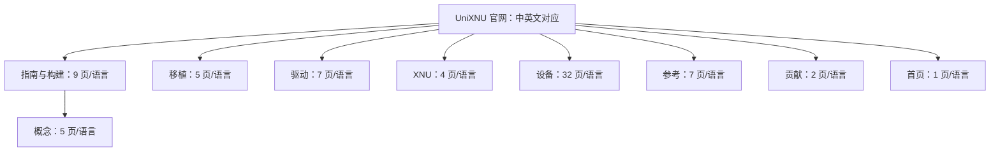

# 官网文档全站遍历与 enuma 路线核对

审阅日期：2026-10-22。指定入口：[移植](https://unixnu.com/zh/porting/)、[设备](https://unixnu.com/zh/devices/)。

## 结论

**继续 iPadOS 17.7.11 / iPad7,1 / j120ap / XNU 10063.141.1 / 4 KiB 路线。当前优先级保持 UEFI/GOP → XNU 基础平台 → NT36523；需要补齐版本一致的静态库构建链、完整 ADT 和后续根卷方案。** 官方 sheng 使用同一 IPSW 身份；不需要因其他社区移植使用 iOS 16 而切换 donor。[sheng](https://unixnu.com/zh/devices/sheng)、[构建环境](https://unixnu.com/zh/guide/requirements)

本仓的诊断 `stop-stage 10` 是 UEFI 内部的调度前检查点。**按官网的七阶段定义，我们仍处于阶段 1 内部，尚未完成 GOP、菜单和负载卷验证。** 六次复位门实测不是官网的第六或第十阶段，更不表示 XNU 已启动。[bring-up 顺序](https://unixnu.com/zh/porting/bring-up)

本轮为文档和已有证据核对：未操作设备、生成镜像、刷写、改内存字段或设置验证标记；未更新固定构建来源。网页中的命令、地址、刷写和组织管理说明是资料，不是用户本轮授权，也不替换本仓 AGENTS/nuwa 规则。

## 遍历范围与可核对证据

- 144 个文档页面全部 HTTP 200：中文 72、英文 72；中文正文逐页审阅，英文完成结构和关键技术段落交叉核对。
- 从两个指定入口沿导航、侧栏、正文及语言切换链接，可以到达全部 144 页；3836 条去重有向页面链接，无不可达页面。
- 与官方 Git 树列出的 144 个 Markdown 路由逐项一致；不是只看当前侧栏。`sitemap.xml` 返回 404，改用源码清单交叉检查。
- 223 个站外链接已编目，不把它们所指向的全部 GitHub 历史、社交网站、IPSW 和静态资源算作“全站遍历”。
- 发现 1 个中文跨页锚点失效，页面仍可访问，详见清单。

[完整 72 页中英文对照清单](2026-10-22-official-site-inventory.md)；`reports/enuma-official-docs-audit.json` 记录 144 页的 URL、HTML 哈希、时间、标题及完整链接图。全文 HTML/文本仅缓存于忽略的 `out/official-docs/`，不在公开仓库重发文档全文。

复查工具为 `scripts/crawl_official_docs.py`，使用 Python 标准库、三个并发请求及有限页面/响应大小；首次运行用已登录的 `gh` 读取官方 HEAD 与完整树，后续复用 out 中的源索引。运行 `python -B scripts/crawl_official_docs.py`；结果在 out/official-docs/crawl.json，工具不改板级文件、不跟随站外链接或执行网页脚本。重查时应明确使用原源索引还是重新获取的新版本，不能覆盖历史审核报告冒充同一快照。

官网结构如下；每个节点还包含其全部子页，具体路由见清单：

官方文档源码参考 HEAD 为 [`d704728a6df9d1eb113873dc1b57e87f6846e361`](https://github.com/UniXNU/UniXNU/tree/d704728a6df9d1eb113873dc1b57e87f6846e361/docs)。它是查询时的源清单版本，不是站点部署版本的证明；网页内容由独立 HTML 哈希绑定。

## 对当前实现的直接帮助

| 主题 | 官网给出的契约 | enuma 当前事实与动作 |
| --- | --- | --- |
| UEFI 黑屏 | GOP、输入、Block I/O、Simple FS、FV2 分别有消费者；进入固件与启动应用是不同阶段 | 当前已走到 CoreDispatcher 前。继续在调度器的 Load/StartImage、DisplayDxe 依赖链、BDS 与 Probe 入口前后加门，取得哪个模块返回、哪个协议发布的证据。81 文件/33 OEM 字节审计只证明装入，不能证明 dispatch 或 GOP 成功。[UEFI](https://unixnu.com/zh/porting/uefi-firmware)、[UEFI 驱动](https://unixnu.com/zh/drivers/uefi-drivers) |
| 面板保持 | sheng 的 ABL 需要 splash 节点，缺少时关闭面板 | 值得优先核对本机最终交给 fastboot boot 的 FDT。缓存 Android FDT 已有 `cont_splash_region@9c000000`，不能直接判定缺 splash 或照搬 sheng 地址，详见下节。[sheng](https://unixnu.com/zh/devices/sheng) |
| 静态库与链接 | 先取得真实 XNU 编译记录，再按依赖顺序构建 archives、最终链接和预链接 | 本仓只完成通用编译尝试，完整 enuma archives/prelink 仍缺。应复用 corecrypto、pthread、ArmDTPlatform、ArmCpu 的真实 builders，并按对应版本补入本板适配。主机 C 测试/AArch64 对象不等于 IOKit 链接。[构建内核](https://unixnu.com/zh/guide/build-kernel) |
| ADT | 顶层节点、CHRP NVRAM proxy、熵、平台种子及输入占位符共同构成 loader/platform 契约 | 2956-byte 硬件片段仍不是完整 ADT。复用编码器与 NVRAM 构造，补 `/chosen`、`/defaults`、`/options`、产品身份和占位符；DRAM/GOP 值待实际 map，不能从 Android FDT 或 sheng 预算推定。[设备树](https://unixnu.com/zh/porting/device-tree) |
| iPad 身份 | IPSW 用户态、根 `model`、`target-type`、`/product`、`/buttons` 要一致，根 compatible 保留本板 | 保持 iPad7,1/j120ap；不把根 compatible 改成 Apple 板名。`ipad_identity` 是脚本参数，不是独立的 OS 开关，固定生成器还控制安全属性。MobileGestalt 缓存需在后续 Data seed 中考虑。[身份](https://unixnu.com/zh/guide/mobilegestalt) |
| 驱动分层 | UEFI `.efi`、内置 XNU 静态库、暂存 kext 是不同机制 | 原厂 DisplayDxe 提供 UEFI GOP，不是 XNU 显示驱动；Android NT36523 源是协议/硬件参考。当前 DarwinBoot 拒绝暂存 kext，首阶段应使用内置真实 IOKit 驱动、personality 与 force-load 链。[分层](https://unixnu.com/zh/drivers/overview)、[kext](https://unixnu.com/zh/drivers/kexts) |
| NT36523 | Novatek 示例把纯核心、总线、板级 MMIO、探针和 HID 发布分开，并逐阶段观察 | 复用 GENI、分阶段探针及快照/HID 架构；继续使用本机 NT36523 解码，不能改为 NT36532E 的 THP 矩阵/固件下载协议。FWINFO、坐标、IRQ、缓存/DMA/SMMU 需要独立证据。[Novatek](https://unixnu.com/zh/drivers/native-novatek-touch) |
| 根卷与用户态 | 原始 OS/SystemOS、SHNGROOT、UUID、原生块驱动、trust cache 与 Data seed 共同闭合 | 后续先审查 SM8250 UFS/PHY/时钟/电源路径，再按本机 GPT 生成 userdata 并核对 UUID。保留 iPadOS/APFS 路线，不套用社区 iOS16/HFSX 镜像。512 MiB 是第一入口预算，完整用户态须另算实际输入占用。[userdata](https://unixnu.com/zh/concepts/userdata)、[预链接](https://unixnu.com/zh/concepts/prelink) |

## 与黑屏直接相关的 splash 核对

只读解析已有 `out/device/live-fdt.bin`，SHA256 `643aa3ec450139d38f8cde9a94bca6d9e8e75e752cb7aa992685d34267434c62`：

- 有 `/reserved-memory/cont_splash_region@9c000000`，label 为 `cont_splash_region`，reg 为 `0x9c000000 + 0x2300000`（35 MiB）。
- 没有名称完全为 `/reserved-memory/splash_region` 的节点。
- 这是 Android 运行时树，可能含 ABL/DTBO fixup，不等于本轮临时启动实际交接树。节点存在也不证明面板仍上电、framebuffer 格式或 GOP 初始化成功。

证据：`reports/enuma-docs-splash-crosscheck.json`。合理下一步是比较 stock vendor_boot/DTBO 与临时启动路径的最终树，核对本机 ABL 按路径还是 label 查找，随后观察 DisplayDxe 的协议状态。**不能据此声称找到黑屏根因，也不能直接加入 sheng 的 `0xb8000000` 区域。**

官网记录的 Silicium 偶发停顿来自 sheng。它提供受控重试的参考，不构成 enuma 黑屏的解释；本仓仍以分点证据定位，不原样盲重试首个黑屏候选。[排错](https://unixnu.com/zh/reference/troubleshooting)

## 新文档与固定源码的版本差异

| 项目 | 当前构建来源 | 本轮查看的官方源码 |
| --- | --- | --- |
| UniXNU | `75bc13dd34dc4e403826793739e316a264ce00dd` | `d704728a6df9d1eb113873dc1b57e87f6846e361` |
| 提交差 | 保持固定 | 领先 89 个提交 |
| 完整树差异 | 未更新 | 509 个文件/条目变化，gitlink 从 0 增为 21 |
| XNU 目标 | 10063.141.1 / Darwin23.6 | 仍是同一目标，不需要换 iPadOS donor |
| kernel orchestration | 没有新的 `build_archives()` 调度 | 编译记录 bootstrap、archive builders、存储头准备、最终链接 |
| 外部参考 | 四个内核参考及 edk2 | 还加入 libpthread、corecrypto-2023、IOStorageFamily |

完整树元数据差异见 `reports/enuma-upstream-docs-comparison.json`。GitHub compare API 首次返回的文件列表封顶 300，已改用双方完整 Git tree 对比；509 是完整清单计数。**它不等于已逐行审查 509 个文件。** 本轮只深入核对构建/打包接口、模块结构及相关诊断补丁，未升级任何锁定版本。

新官网已有[官方 macOS workflow](https://github.com/UniXNU/UniXNU/blob/d704728a6df9d1eb113873dc1b57e87f6846e361/.github/workflows/macos.yml)，支持设备仓/ref/defconfig、`pre_build`、kernel、userdata、payload 及外部 seed。可复用其阶段安排和证据收集，不能直接用默认 `kernel userdata` 跑不完整的 enuma 配置；21 个模块子仓也必须固定提交。我们的固定 runner/Xcode 预检仍有价值。[构建](https://unixnu.com/zh/building)、[仓库布局](https://unixnu.com/zh/contributing/repository)

### 本次 CI 的实际结论

预检 run 39784132935 通过。随后 [bootstrap run 39784240390](https://github.com/wh1stl3/UniXNU-enuma/actions/runs/39784240390) 已失败：XNU 编译推进至最终链接，`_bsd_init` 引用的 `_native_legacy_display_probe` 未解析。不能继续记录为“运行中”或“基线构建通过”。artifact 与完整日志已回读，日志摘要保存在 `reports/enuma-macos-bootstrap-run.json`。

固定 `offline-component-load-probes.patch` 第 78–79 行在运行时参数条件下引用真实 legacy probe，而自定义 bootstrap 关闭显示静态库，仍会留下链接引用。**本轮检查的新 HEAD 也保留此调用，单纯切换最新版不能保证修复。** 建议下一次独立 build 提交优先按真实功能开关保护未选中的调用，并核对完整符号表；另一方案是按正确 ABI 构建并链接真实显示归档，依赖面更大。两者都不使用空 stub 冒充驱动。本轮不修改内核补丁，也不重新触发 CI。

### 文档示例需要源码复核

发现两处具体差异，说明示例不能逐字复制：

1. 文档 `[kernel] archives` 示例带 `scripts/` 前缀；当前固定审阅 HEAD 的 `scripts/unixnu/kernel.py` 又用 `ctx.tree / 'scripts' / parts[0]` 解析，照抄会得到双重目录。实施时以选定版本的实际解析和 builder 文件为准。
2. [XNU 驱动页](https://unixnu.com/zh/drivers/xnu-drivers) 的示例把 `probe()` 写为 bool；实际固定 XNU `iokit/IOKit/IOService.h:664` 返回 `IOService *`。enuma 的 IOKit 类必须遵循真实头文件及编译记录，不能照抄该签名。

通用页描述 header v0/gzip/追加 DTB，也不能覆盖 enuma 已有 raw boot v3 + stock vendor_boot 的实测契约。当前路径已执行到 DXE 调度前，继续按本机证据保留；只有具体需求和回归证明才能改变封装。

## 社区实现复用优先级

以下运行状态均是官网当时的记录，不是本轮独立重测。

| 来源 | 对 enuma 的价值 | 边界 |
| --- | --- | --- |
| [sheng](https://unixnu.com/zh/devices/sheng) | 同一 iPadOS donor、完整预链接/根/显示/HID 框架，是通用链路首选参考 | SM8550、NT36532E、A740、PMGR、存储几何和大内存预算不继承 |
| [pipa](https://unixnu.com/zh/devices/pipa) | 同为 SM8250，优先检查其公开地址来源、UEFI/Kona 布局和板级差异 | 尚无实机证明、缺存储驱动，不能把“同 SoC”理解为已有可直接运行的完整驱动 |
| [nabu](https://unixnu.com/zh/devices/nabu) | Pad5 家族的 UEFI→菜单→DarwinBoot→XNU 分阶段经验 | SM8150，官网仍把 PMGR/用户态列为后续，不能代替 enuma 电源或触控适配 |
| [guacamole](https://unixnu.com/zh/devices/guacamole) / [sweet](https://unixnu.com/zh/devices/sweet) | 老平台交接、纯逻辑隔离、A6xx legacy HFI 的研究线索 | iOS16/不同 SoC 与 ABI；不复制其 3 GiB 窗口、HFS 路线、board 值或镜像 |
| [piano](https://unixnu.com/zh/devices/piano) / [uke](https://unixnu.com/zh/devices/uke) | 真实 archive/预链接 CI 与 first-console/full 配置分层 | CI 成功、入口色条与用户态是不同证据级别，设备硬件参数不沿用 |
| [QEMU](https://unixnu.com/zh/devices/qemu) / [DroidVM](https://unixnu.com/zh/devices/droidvm) | iPadOS17 CPU 渲染、根卷/身份/用户态的独立验证参考；GPU 可后置 | ramfb/VirtIO/虚拟化不等于 enuma GOP/UFS/SMMU，不能借虚拟机结果宣称平板可用 |
| [PHY120](https://unixnu.com/zh/devices/phy120) | OEM Env/Smem/DALSys 等 DXE 卡点的排查经验 | SM8650 且固件环境不同，只帮助设计门的位置，不是 enuma 根因证明 |

旧源码和驱动报告中已固定的 MiCode enuma 源、本机 XBL/OEM 驱动与 live FDT 继续作为硬件参数证据，社区仓库补充结构和实现参考。

## 后续推进顺序与验收

1. **UEFI 调度/GOP**：在当前 stage10 之后缩小到具体模块/协议，核对本机 splash，观察 GOP base/stride/format 和 GetMemoryMap，再确认 UniXNU 菜单、输入与 FAT 负载卷。进入 DXE、GOP 可用、菜单可见、卷可读分别记录。
2. **版本一致的源码构建**：独立修复未选显示功能的链接引用；审查并复用 archive/bootstrap/模块固定方案。先获得 ARM64/iOS17/4 KiB、无未解析符号的内核，再按目标 kernelcache 审查 prelink。编译记录生成时允许的 bootstrap 链接失败不能当成最终内核通过。
3. **完整 ADT 与基础平台**：复用真实编码器、CHRP proxy、ArmDTPlatform/ArmCpu 和 personality；先完成 QEMU 的 UniXNU→DarwinBoot 契约检查，再回实机核对 CPU/GIC/定时器。QEMU 数值只用于 QEMU。新 DRAM 大小/基址或新窗口预算仍触发本仓内存审查。
4. **NT36523 与软件显示**：按时钟/引脚→GENI/ID→FWINFO/帧→IRQ/IOKit/HID 的顺序推进，默认关闭未观察硬件阶段。用真实 GOP 和正确显示 ABI 争取 CPU 渲染/输入，A650 GPU 后置；“GPU 后置可行”是参考路线，不是现成 enuma 软件显示驱动的证明。
5. **UFS→根→Data→用户态**：核对 SM8250 PHY/时钟/复位/SMMU 与本机 GPT，连接原始 OS/SystemOS、trust cache、root UUID、Data seed、MobileGestalt。最后再做持久化与 Setup；不先照搬 sheng-pmgr 或日志写区。

官网的无人值守方案依赖 XNU、NativeUfs 已读取根布局、PMIC reboot-reason cell 以及 userdata 日志窗口；它晚于我们当前阶段。早期继续复用已有 PSCI 复位门，后期再审查移植日志协议，不能现在直接启用 `sheng-log`/`sheng-autoreset` 或复制其尾部写区。[无人值守](https://unixnu.com/zh/devices/sheng-unattended-test)

## 仓库与待决边界

官网推荐设备仓和 `uefi-<device>` 分开。当前 `UniXNU-enuma/firmware/` 是有完整构建/原厂输入/实测记录的隔离增量原型，尚无单独 `uefi-enuma` 远端。建议后续保持这些证据可重建，再整理成单独固件仓并互锁提交；拆仓不是当前黑屏的技术前置，也不应通过目录整理替代运行验证。本轮仅提出建议，未创建第二个远端。

本次无需新增硬停审批。仍需实机才能关闭的事项为：DXE 模块返回与协议、GOP/面板保持、UEFI 可用连续窗口和 EBS、CPU/IRQ/PSCI、NT36523 总线/固件/IRQ/HID、UFS/PMGR 与根卷。文档遍历不能代替任何一项；需要改内存配置或验证标记时再提交具体证据和最小范围。
